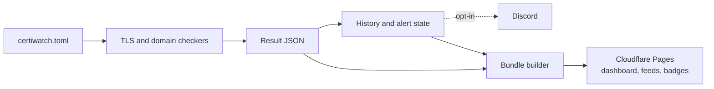

<!-- prettier-ignore -->
<div align="center">

# CertiWatch

**Catch expiring TLS certificates and domain registrations before your users do.**

[](https://github.com/nooblk-98/certiwatch/actions/workflows/ssl-check.yml)
[](https://www.python.org)
[](.github/workflows/ssl-check.yml)
[](https://pages.cloudflare.com)

[Live demo](https://ssl-domain-monitor.pages.dev) • [Features](#features) • [Quickstart](#quickstart) • [Configuration](#configuration) • [Deployment](#deploy-with-github-actions) • [Public feeds](#public-feeds) • [Lifecycle docs](docs/monitoring-lifecycle.md)


</div>

CertiWatch is a self-hosted certificate and domain expiry monitor that needs no server or database. List your domains in one TOML file, and a daily GitHub Actions run checks them, then publishes a static dashboard, a status API, a calendar feed, and badges to Cloudflare Pages.

## Features

- **TLS certificate checks**: issuer, validity dates, chain trust, SAN hostname match, and fingerprint changes, on any port.
- **STARTTLS support**: monitor SMTP, IMAP, and POP3 endpoints alongside HTTPS.
- **Domain expiry tracking**: RDAP with a WHOIS fallback, plus a dedicated lookup for `.lk` domains.
- **DNS and security diagnostics**: NS, CAA, DNSSEC, and HSTS checks, with optional legacy TLS 1.0/1.1 probing.
- **Interactive dashboard**: search, filter, sort, expiry timelines, history, light and dark themes, and CSV or JSON export.
- **Public feeds**: `status.json`, an iCalendar expiry feed, and an SVG badge for each domain.
- **Discord alerts**: opt-in notifications for status, threshold, and certificate changes, with at-least-once delivery.
- **Safe publishing**: a run that could not read any certificate fails the build and leaves the live site untouched.

## How it works



Results are build artifacts and are never committed back to the repository. Public history is kept in the GitHub Actions cache, and private alert state is kept in an optional Cloudflare KV namespace.

## Quickstart

You need [Python 3.11+](https://www.python.org/downloads/). Python 3.13+ is recommended because older versions can only report the leaf certificate instead of the full chain.

```bash
git clone https://github.com/nooblk-98/certiwatch.git
cd certiwatch
python3 -m venv .venv
source .venv/bin/activate  # Windows: .venv\Scripts\activate
python -m pip install -r requirements.txt
```

Edit the targets in `certiwatch.toml`, then run the checks and build the site:

```bash
python src/validate_conf.py --no-dns
python src/ssl/scripts/check_ssl.py --config certiwatch.toml
python src/domain/scripts/check_domains.py --config certiwatch.toml
python src/monitor_state.py --config certiwatch.toml --transport none
python scripts/build_dist.py --out dist
python -m http.server --directory dist 8000
```

Open <http://localhost:8000> to see your dashboard.

> [!TIP]
> `--transport none` is the default and sends no alerts, so it is safe for local runs.

## Configuration

All monitoring is configured in [`certiwatch.toml`](certiwatch.toml) and validated against [a JSON Schema](schema/certiwatch.schema.json). Unknown keys are rejected, so a typo cannot silently disable a check.

```toml
version = 1

[defaults]
ssl_port = 443
thresholds = [30, 14, 7, 1]  # notice, warning, urgent, critical (days)
history_limit = 365
check_dns = true
check_hsts = true
check_legacy_tls = false

[alerts]
discord = false

# HTTPS certificate and domain registration
[[targets]]
domain = "example.com"
registration = true
tags = ["public", "core"]
group = "corporate"

# Mail server over STARTTLS
[[targets]]
domain = "mail.example.com"
ssl_port = 587
tls_mode = "starttls"
starttls_protocol = "smtp"
```

> [!WARNING]
> `owner` and `notes` are left out of generated files, but `certiwatch.toml` is tracked in Git. In a public repository every value is public, so never put secrets in it.

### Target options

| Option | Default | Description |
| --- | --- | --- |
| `domain` | required | Host, `host:port`, or URL |
| `ssl` | `true` | Check the TLS certificate |
| `registration` | `false` | Check domain registration expiry |
| `ssl_port` | `443` | TLS port for this target |
| `tls_mode` | `direct` | `direct` or `starttls` |
| `starttls_protocol` | `smtp` | `smtp`, `imap`, or `pop3` |
| `https` | auto | Whether the endpoint serves HTTPS. HSTS is only checked when true |
| `dns_name` | registration domain | Name used for NS, CAA, and DNSSEC checks |
| `check_dns`, `check_hsts`, `check_legacy_tls` | from `[defaults]` | Per-target diagnostic overrides |
| `tags`, `group` | none | Public metadata included in results |
| `owner`, `notes` | none | Reference fields that are not emitted |

### Environment variables

| Variable | Default | Description |
| --- | --- | --- |
| `SSL_CHECK_TIMEOUT` | `15` | TLS connection timeout in seconds |
| `SSL_CHECK_WORKERS` | `20` | Parallel TLS checks |
| `SSL_CA_FILE` | system store | Custom CA bundle, for example for a private CA |
| `DOMAIN_CHECK_DELAY_SEC` | `0.35` | Delay between domain lookups |
| `LK_CHECK_DELAY_SEC` | `0.8` | Delay between `.lk` lookups |
| `LK_CHECK_MAX_DELAY_SEC` | `5.0` | Maximum `.lk` retry delay |
| `LK_CHECK_MAX_RETRIES` | `3` | Retries for failed `.lk` lookups |

## Deploy with GitHub Actions

`.github/workflows/ssl-check.yml` is the single workflow that runs the checks
and deploys to Cloudflare Pages, for both production and previews. Nothing is
deployed by hand. The only other workflows are the reusable, secret-free
`verify.yml` and the PR-only `pr-verify.yml`.

### Triggers

| Trigger | What runs |
|---|---|
| `pull_request` | `pr-verify.yml` calls the reusable offline checks. A pull request never publishes, needs no secrets, and makes no external probes. |
| `push` to `main` | `ssl-check.yml` runs the same offline checks, then the certificate checks and a production publish. Only for files that affect the checks, the dashboard or the published bundle. |
| `push` to `dev`, `develop`, `development`, `development/*` or `development/*/*` | The same offline checks, then the certificate checks and a preview publish. No other branch, tag or pull request deploys. |
| `schedule` | Every day at **06:00 Asia/Colombo (UTC+5:30)**, i.e. **00:30 UTC**. |
| `workflow_dispatch` | Manual run from the GitHub Actions tab. Publishes production from `main` only; it never deploys a preview. |

Superseded preview runs on a development branch are cancelled. A run on `main`
is never cancelled mid-publish: a second one waits behind it
(`concurrency: certiwatch-${{ github.ref }}`).

### Automated checks

The `verify` job runs offline on every trigger and must pass before anything can
be published:

| Check | Command |
|---|---|
| Unified config contract (offline) | `python3 src/validate_conf.py --config certiwatch.toml --no-dns` |
| Python unit tests (in-memory certificates, local TLS servers/fakes only) | `python -m pytest -q -p no:cacheprovider` |
| Dashboard tests | `node --test tests/dashboard.test.mjs` |
| Publish-bundle and feed tests | `python3 scripts/test_build_dist.py` |

Run the same four commands before opening a pull request. None needs network
access, credentials, previous history or private state, so a pull request can be
verified on a fork. Pull requests do not run either checker, do not restore the
history cache, do not touch the KV namespace and cannot deploy.

The checks live in the reusable, no-secret `verify.yml`. A dedicated
`pr-verify.yml` calls it on every pull request, and both the production and
preview jobs call it as their `needs: verify` dependency. The split means PR
verification can run even when the publish workflow has been disabled for
repository inactivity; the PR workflow has no secrets and no publish path.

The production job runs only for `github.ref == 'refs/heads/main'`, so a `main`
run - push, schedule or manual - cannot deploy unless every check passes first.
The preview job runs only for a `push` to one of the named development branches;
a manual dispatch is skipped rather than publishing.

### What a publishing run does

1. Fails when a required input is missing, empty or a symlink (`certiwatch.toml`,
   `schema/certiwatch.schema.json`, `index.html`, `pages/_headers`,
   `scripts/build_dist.py`, `scripts/build_public_feeds.py`,
   `scripts/alert_state_store.py`, `src/config.py`, `src/monitor_state.py`).
2. Validates `certiwatch.toml` against the schema (the legacy `.conf` files are
   not consulted while TOML exists).
3. Restores public `history.json` from the Actions cache on `main` only.
4. Runs the SSL and domain checkers with `--config certiwatch.toml`.
5. Optionally pulls the private alert state from the dedicated KV namespace.
6. Runs `src/monitor_state.py`: writes the public history snapshot, writes the
   pending batch to the remote KV checkpoint, and only then delivers opt-in
   events. A checkpoint failure means zero sends.
7. Saves public history back to the Actions cache even after a delivery
   warning. `monitor_state.py` owns all private checkpoint writes; there is no
   redundant post-run KV put.
8. Stages the atomic publish directory with `scripts/build_dist.py`, including
   the feeds and history.
9. Deploys `dist/` to Cloudflare Pages, from `main` only.

It does **not** commit the results back to `main`; see
[Generated data and Git](#generated-data-and-git).

### What a preview run does

A preview is a real deploy of the checked development branch, kept in a
separate Cloudflare account and a distinct Pages project:

1. Fails closed unless the `certiwatch-preview` environment provides both
   preview secrets and the required `CERTIWATCH_PREVIEW_PROJECT` variable. It
   never falls back to the production token, project, or repository secrets.
2. Refuses to continue when the preview account equals the trusted production
   account, or the preview project equals the production project.
3. Validates `certiwatch.toml` and runs the SSL and domain checkers.
4. Builds `dist/` with `scripts/build_dist.py`. No history is restored and
   `monitor_state.py` is never run, so the bundle has no alert state.
5. Deploys `dist/` to the separate preview project on a preview branch.

The production account and project are untouched. The preview job never reads
or writes the production `history.json`, the KV alert checkpoint, or the Discord
transport. It has no access to any `CERTIWATCH_PRODUCTION_*` secret; it only
sees the environment-scoped `CLOUDFLARE_PREVIEW_*` values.

A preview branch alias is derived from the ref with an allowlist: lowercased,
`/` and other separators become `-`, only `a-z`, `0-9`, `.`, `_` and `-` survive,
the slug is capped at 48 characters, and a deterministic eight-character
SHA-256 prefix of the **full ref** is appended. The hash prevents collisions
such as `development/api/v2` and `development/api-v2` mapping to the same
alias. For example `development/team-feature` deploys as
`development-team-feature-218ee579`, while `development/team/feature` deploys
as `development-team-feature-bb8acb47`. A flat `development/api` push deploys
as `development-api-671f86aa`, reachable at
`https://development-api-671f86aa.<preview-project>.pages.dev`.

Preview branches are supported to **two levels under `development/`**
(`development/*` and `development/*/*`). Deeper branches do not trigger the
workflow, because a GitHub environment branch policy matches one path segment
per `*` and does not let `**` cross `/`; an unbounded `development/**` trigger
could not be matched by the environment policy. The alias and project are
validated before they are interpolated into the deploy command, so a branch
name or repository variable cannot add command arguments.

**Preview results are public.** Cloudflare Pages preview deployments are
reachable on the public internet by default, and the bundle contains the same
public certificate and domain results as production. A preview has no history
and no alerts, but it must still be treated as a public publishing surface. If
a preview must be private, put Cloudflare Access in front of it; do not rely on
an unguessable hostname.

The same path filter as production applies: a preview deploys when a push to a
development branch changes the checks, configuration, dashboard or bundle
inputs. A docs-only push does not redeploy.

### Removed workflow

`release.yml` (Auto Release Notes) was removed. It ran an unrelated third-party
action on `release: created` with `contents: write`, and used a hosted model to
rewrite release notes. Release-note wording belongs to the Technical Writer and
release state to the Issue & Release Coordinator, neither of which needs a
write-scoped token in this repository. Removing it also drops an unnecessary
third-party Actions dependency. GitHub may continue to list `Auto Release Notes`
in the Actions tab until the deletion lands on the default branch; it cannot run
once the file is gone.

### Publish safety rules

`scripts/build_dist.py` refuses to build rather than publish something wrong:

- **Missing, empty or malformed input**, including a result file with no rows.
- **Unreadable TLS run**: when *every* SSL row ended in DNS, connection,
  handshake or input failure (`dns_error`, `timeout`, `no_https`, `ssl_error`,
  `error`), no certificate was read. That is a runner without egress or a
  network outage, so production is left untouched. Any run containing at least
  one real verdict (`valid`, `expired`, `invalid`) publishes normally, so
  expiring and invalid certificates are still reported.
- **Symlinked inputs**: a symlinked file, or a symlinked parent directory such as
  `pages`, is refused, so nothing outside the checkout can enter the bundle.
- **Malformed public history**: a present `history.json` must be an object with
  a non-empty `snapshots` list, valid unique `YYYY-MM-DD` dates and both row
  lists. Invalid history fails the build instead of publishing a corrupt chart.
- **Unsafe destinations**: output outside the checkout is allowed; inside it only
  `dist` is. A non-empty destination is replaced only if every entry is a file
  this builder produces and `_headers` is present; otherwise it is refused and
  left intact.
- **Strict generated allowlist**: feed output is limited to `status.json`,
  `expiries.ics`, `badges/manifest.json` and badge names matching
  `<slug>-<sha256:32>.svg`. A foreign nested file or directory under `badges/`
  refuses the rebuild. A repeat build accepts the previous bundle, including a
  stale badge it will replace.

The build assembles a hidden sibling directory, generates the feeds into it,
and swaps it into place at the end. A failed feed, history or copy step never
leaves a half-filled `dist/` behind for a deploy step to publish.

### Published bundle

Only the files below are uploaded:

| Path in `dist/` | Source | Required |
|---|---|---|
| `index.html` | `index.html` | yes |
| `ssl_results.json` | generated by `check_ssl.py` | yes |
| `domain_results.json` | generated by `check_domains.py` | yes |
| `_headers` | `pages/_headers` | yes |
| `status.json` | generated by `build_public_feeds.py` | yes |
| `expiries.ics` | generated by `build_public_feeds.py` | yes |
| `badges/manifest.json` | generated by `build_public_feeds.py` | yes |
| `badges/<slug>-<sha256>.svg` | generated by `build_public_feeds.py` | yes, one per domain |
| `history.json` | generated by `monitor_state.py` | no, copied when present |
| `app.js` | `app.js` | no, copied when present |
| `style.css` | `style.css` | no, copied when present |

`scripts/build_dist.py` owns this list. Sources, images, workflows, private
state and configuration never reach the public site. Badge names are dynamic,
so the builder accepts only the manifest plus the exact hash-suffixed SVG
pattern; adding any other runtime file means an explicit reviewed change.

`pages/_headers` sets `no-cache, must-revalidate` on the four JSON endpoints so
a new deployment is visible immediately. The calendar and badges may be reused
for five minutes (`max-age=300`) and then revalidate. It also sets
`application/json`, `text/calendar` and `image/svg+xml` content types. Confirm
the served headers once after the first deploy; Pages controls some MIME types
itself.

### Required GitHub configuration

Nothing below is applied by this repository. An administrator must configure it
before enabling previews or merging this change.

#### Repository variables

These are non-secret, trusted settings under
**Settings → Secrets and variables → Actions → Variables**:

| Name | Required | Description |
|---|---|---|
| `CERTIWATCH_PRODUCTION_ACCOUNT_ID` | yes | Production Cloudflare account ID. Used only for consistency and separation checks; it does not replace account isolation. |
| `CERTIWATCH_PRODUCTION_PAGES_PROJECT` | no | Production Pages project; defaults to `certiwatch`. |

#### `certiwatch-production` environment

Create the environment under **Settings → Environments**. Under
**Deployment branches and tags**, choose **Selected branches and tags** and
allow **`main` only**. This binds the production credentials to production, so
a job on any other ref cannot read them even if the workflow file changes.

| Name | Kind | Description |
|---|---|---|
| `CERTIWATCH_PRODUCTION_PAGES_API_TOKEN` | environment secret | Pages edit token for the production account |
| `CERTIWATCH_PRODUCTION_PAGES_ACCOUNT_ID` | environment secret | Production account ID; must equal `CERTIWATCH_PRODUCTION_ACCOUNT_ID` |
| `CERTIWATCH_PRODUCTION_DISCORD_WEBHOOK` | environment secret, optional | Discord webhook URL, read by `monitor_state.py` only |
| `CERTIWATCH_PRODUCTION_STATE_KV_TOKEN` | environment secret, optional | KV-edit token used only for the alert-state namespace; do not reuse the Pages token |
| `CERTIWATCH_PRODUCTION_STATE_KV_NAMESPACE` | environment variable, optional | KV namespace id for private alert state |
| `CERTIWATCH_PRODUCTION_ALERTS_ENABLED` | environment variable, optional | Set to `true` to allow production Discord delivery; default off |

Create the KV namespace and its token manually in Cloudflare; this repository
never creates or rotates credentials. A token limited to **Workers KV
Storage:Edit** for the production account is enough. The workflow writes the key
`certiwatch-alert-state`; it does not list or read any other key. If the KV
variables are absent, the workflow skips both KV steps and runs with
`--transport none`.

#### `certiwatch-preview` environment

A Cloudflare API token with Pages edit is **account-scoped**: it can act on any
Pages project in that account. Project-scoped Pages tokens are not assumed or
claimed here. The only real isolation boundary is a **separate Cloudflare
account**, so create one for previews, plus a Pages project in that account
whose name differs from production.

Create the environment under **Settings → Environments** and add these to that
environment only:

| Name | Kind | Description |
|---|---|---|
| `CLOUDFLARE_PREVIEW_API_TOKEN` | environment secret | Pages edit token for the separate preview account |
| `CLOUDFLARE_PREVIEW_ACCOUNT_ID` | environment secret | Preview account ID; rejected if it equals the production account |
| `CERTIWATCH_PREVIEW_PROJECT` | environment variable, **required** | Distinct preview Pages project; there is no default |

Under **Deployment branches and tags**, choose **Selected branches and tags**
and allow exactly `dev`, `develop`, `development`, `development/*` and
`development/*/*`. These are the same patterns as the workflow trigger.

The two match because GitHub environment rules use Ruby `File.fnmatch`
semantics: one `*` matches exactly one path segment and never crosses `/`, and
`**` does not cross `/` either. A single `development/**` rule would therefore
cover only one level, and a policy with only `development/*` would also fail a
nested `development/team/feature` push. Listing both depths keeps the policy
identical to the supported trigger; a deeper branch is outside the supported
set and does not trigger a job. Required reviewers are optional but
recommended.

The preview job fails when either secret or the project variable is missing, and
it refuses a preview that resolves to the production account or project. It
never reads repository-level production secrets.

#### Migration and removal of old repository secrets

The previous revision read repository-level `CLOUDFLARE_API_TOKEN`,
`CLOUDFLARE_ACCOUNT_ID`, `CERTIWATCH_STATE_KV_TOKEN`,
`CERTIWATCH_DISCORD_WEBHOOK`, and the variables `CLOUDFLARE_PAGES_PROJECT`,
`CERTIWATCH_STATE_KV_NAMESPACE` and `CERTIWATCH_ALERTS_ENABLED`. No workflow in
this change references those names.

**Delete all of those old repository-level secrets and variables after adding
the environment-scoped replacements and before enabling previews.** Leaving
them in place provides no benefit and keeps credentials usable by any workflow
that names them. Verify the Actions secrets/variables list is empty of the old
names, then enable the preview environment.

#### Activation gates

Do these in order; none is performed by this repository:

1. Create the `certiwatch-production` environment, bind it to `main`, and add
   its secrets and variables.
2. Create the separate Cloudflare account and preview project; create the
   `certiwatch-preview` environment with its secrets, required project
   variable, and the branch policy above.
3. Add the two repository variables.
4. Delete every old repository-level secret and variable listed above.
5. Protect `main`: require a pull request, require the PR verification check,
   and block direct pushes and force-pushes.
6. Restrict write access to `dev`, `develop`, `development/*` and
   `development/*/*`. A push to one of those branches runs that branch's code
   with the preview token, so write access there is equivalent to permission to
   use the preview credentials.
7. Only then merge this change and let the first preview run.

Rotate a Pages credential by issuing a new Cloudflare API token with Pages edit
permission in the relevant account, updating the matching environment secret,
and revoking the old token. Credentials belong only in the GitHub secret store:
never commit them, paste them into an issue or workflow log, or pass them
through a variable. A token disclosed anywhere else should be revoked and
replaced rather than reused. No DNS challenge credential is used or needed:
deployment goes through the Cloudflare Pages API and the workflow never edits
DNS records.

All actions are pinned to full commit SHAs: `actions/checkout` v4,
`actions/setup-python` v5, `actions/setup-node` v4, `actions/cache` v4, and the
verified `cloudflare/wrangler-action` release `v3.15.0` commit (`9acf94a…`).
A retagged or compromised tag therefore cannot change what runs with an API
token. `checkout` runs with `persist-credentials: false`; no step pushes to Git.

### Rollback

Cloudflare Pages keeps every deployment. To revert a bad publish, open
**Workers & Pages → certiwatch → Deployments**, pick the last known-good
deployment and choose **Rollback**. The site then serves that deployment's
bundle, including its result files, until the next successful run. No Git revert
is needed for a rollback; revert the offending commit separately if it also
changed the dashboard, configuration or checks.

The build step prints a manifest of every published file with its size and
SHA-256 prefix, so the log of a run identifies exactly what was deployed.

## Public feeds

Every deployment publishes these endpoints alongside the dashboard:

| Path | Content |
| --- | --- |
| `/status.json` | Overall status, summary counts, and per-domain results |
| `/expiries.ics` | Calendar of certificate and registration expiries |
| `/history.json` | Daily snapshots, up to `history_limit` |
| `/badges/manifest.json` | Map of each domain to its badge, status, and color |
| `/badges/<slug>-<sha256>.svg` | Status badge for one domain |

Subscribe to `/expiries.ics` from your calendar app to see renewals next to the rest of your schedule.

## Reading the results

| Certificate status | Meaning |
| --- | --- |
| `valid` | The certificate is trusted, matches the host, and has not expired |
| `expired` | The certificate is past its expiry date |
| `invalid` | Chain or hostname verification failed |
| `dns_error`, `timeout`, `no_https`, `ssl_error`, `error` | The check could not read a certificate |

Domain registrations report `active`, `warning`, `urgent`, `expired`, or `unknown`. `unknown` means no lookup source answered, not that the domain is unregistered.

> [!NOTE]
> CertiWatch does not check certificate revocation (OCSP or CRL). Trust is evaluated against the CA store of the machine running the check, so a certificate that works in a browser can be `invalid` if the server omits an intermediate or the runner lacks a recent root.

## Development

Run the same offline checks as CI before opening a pull request. Node.js 22+ is needed for the dashboard tests.

```bash
python -m pip install -r requirements.txt pytest
python src/validate_conf.py --config certiwatch.toml --no-dns
python -m pytest -q -p no:cacheprovider
node --test tests/dashboard.test.mjs
python scripts/test_build_dist.py
```

> [!NOTE]
> Some tests create symlinks. On Windows, enable Developer Mode or run them from an elevated shell.

```text
├── certiwatch.toml    # Monitoring configuration
├── index.html         # Dashboard (with app.js and style.css)
├── schema/            # Configuration JSON Schema
├── src/               # Checkers, config loader, history, and alerts
├── scripts/           # Bundle, feed, and alert-state tooling
├── pages/_headers     # Cloudflare Pages cache and MIME rules
├── tests/             # Offline Python and dashboard tests
└── docs/              # Monitoring lifecycle reference
```

For the history schema, alert state model, failure handling, and CI contract, see the [monitoring lifecycle documentation](docs/monitoring-lifecycle.md).
