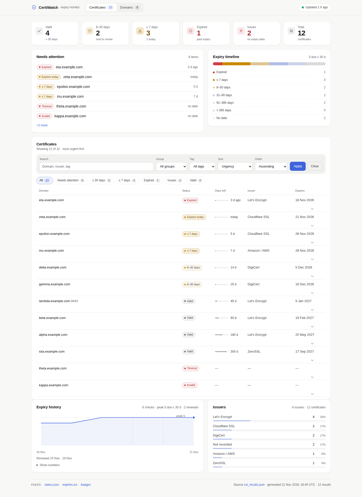
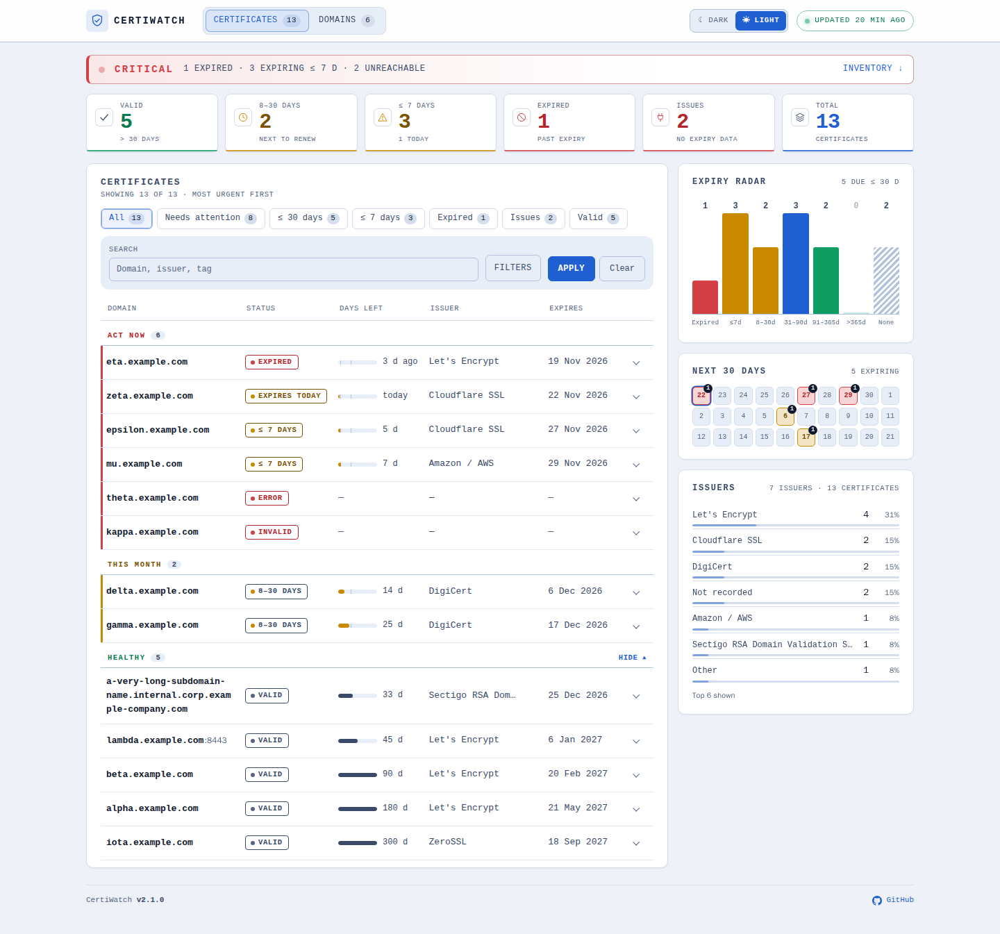

<div align="center">

# CertiWatch

**Never be surprised by an expired certificate or domain again.**

Self-hosted monitoring for TLS certificates and domain registrations, with a
clear dashboard, a renewal calendar and optional Discord alerts. One small
container, no database, no accounts.

[Quick start](#quick-start) · [Features](#features) · [Configuration](#configuration) · [Alerts](#alerts) · [FAQ](#faq)

</div>



<details>
<summary>Light theme</summary>



</details>

*Screenshots use sample data.*

## Why CertiWatch

Expiry problems are quiet until they are an outage. CertiWatch checks your
sites on a schedule, shows what needs action first, and stays calm when
everything is healthy.

- **See the problem at a glance.** A status banner reads `ALL CLEAR`, `WARNING` or `CRITICAL`, and the table lists what to fix first.
- **Know what is coming.** An expiry radar and a 30-day calendar show what renews when.
- **Light on resources.** A single Rust binary in one container with a persistent volume. Nothing else to run.
- **Private by design.** Self-hosted, read-only dashboard, no scripts in your browser.

## Features

**Certificate monitoring**
- Expiry countdown with thresholds at 30, 14, 7 and 1 days (configurable)
- Trust chain, hostname/SAN match, key type and size, TLS version and cipher
- Direct TLS and STARTTLS (SMTP, IMAP, POP3) so mail servers are covered too
- Optional HSTS, legacy TLS 1.0/1.1 and DNS checks (NS, CAA, DNSSEC)

**Domain monitoring**
- Registration expiry through RDAP and WHOIS, including `.lk` domains

**Dashboard**
- Targets grouped by urgency: *Act now*, *This month*, *Healthy*
- Search, status filters, group and tag filters, sortable columns
- Click any row for full certificate details
- Dark and light themes with a one-click switch (your choice is remembered)
- Works on phones and tablets

**Alerts and integrations**
- Discord notifications when a target crosses a threshold
- Calendar feed (`expiries.ics`) you can subscribe to
- JSON status feed and SVG badges for your own pages or READMEs

## Quick start

You need Docker.

```bash
docker run -d --name certiwatch \
  -p 8080:8080 \
  -v certiwatch-data:/data \
  --restart unless-stopped \
  ghcr.io/nooblk-98/certiwatch:latest
```

Open <http://localhost:8080>. The first check takes a moment; the dashboard
fills in as soon as it finishes. The image ships with a small example
configuration so you can see it working straight away.

### Monitor your own sites

1. Create a `certiwatch.toml` (see [Configuration](#configuration)).
2. Mount it into the container:

```bash
docker run -d --name certiwatch \
  -p 8080:8080 \
  -v "$PWD/certiwatch.toml:/config/certiwatch.toml:ro" \
  -v certiwatch-data:/data \
  --restart unless-stopped \
  ghcr.io/nooblk-98/certiwatch:latest
```

### Docker Compose and Portainer

The repository includes a ready-to-use [`compose.yaml`](compose.yaml). Deploy it
as a stack or run `docker compose up -d`. Set `CERTIWATCH_PORT` to change the
port and `CERTIWATCH_TAG` to pin a version, for example `2.2.0`.

To use your own targets with Compose, uncomment the `certiwatch.toml` volume in
`compose.yaml` and point it at an **absolute** path on the host.

## Configuration

Targets live in one file, `certiwatch.toml`. Edits are picked up on the next
check, with no restart needed.

```toml
version = 1

[defaults]
thresholds = [30, 14, 7, 1]   # alert when this many days are left

[[targets]]
domain = "example.com"
registration = true            # also watch the domain registration
tags = ["public", "core"]
group = "corporate"

[[targets]]
domain = "mail.example.com:587"
tls_mode = "starttls"
starttls_protocol = "smtp"
```

A target can be a host, `host:port` or a URL. `owner` and `notes` fields stay
private: they are never shown in the dashboard or sent anywhere. Do not put
secrets in this file.

### Settings

Set these as environment variables on the container.

| Variable | Default | What it does |
| --- | --- | --- |
| `CERTIWATCH_REFRESH_INTERVAL` | `3600` | Seconds between checks |
| `CERTIWATCH_RUN_ON_START` | `1` | Check once at startup |
| `CERTIWATCH_MAX_CONCURRENCY` | `4` | Parallel checks |
| `SSL_CHECK_TIMEOUT` | `15` | Seconds to wait per connection |
| `SSL_CA_FILE` | unset | Extra CA bundle for private CAs |
| `CERTIWATCH_DISCORD_WEBHOOK` | unset | Discord webhook URL for alerts |

## Alerts

To get Discord alerts, turn them on in `certiwatch.toml`:

```toml
[alerts]
discord = true
```

Then pass the webhook URL as `CERTIWATCH_DISCORD_WEBHOOK`. The URL is read from
the environment only; it is never stored or logged.

## Feeds and badges

| Path | What you get |
| --- | --- |
| `/status.json` | Summary of current status for scripts and widgets |
| `/expiries.ics` | Renewal calendar to subscribe to in your calendar app |
| `/badges/` | SVG badges for status and expiry |
| `/ssl_results.json`, `/domain_results.json` | Full latest results |
| `/healthz`, `/readyz` | Health checks for your orchestrator |

## FAQ

**Does it need a database?** No. Results and history are kept as files on one volume.

**How do I back it up?** Back up the `/data` volume. That holds history and alert state.

**How do I update?** Pull the new image and recreate the container, for example `docker compose pull && docker compose up -d`. Your data and configuration are untouched.

**Can I run two copies against the same volume?** No. Use exactly one container per data volume.

**Can I trigger a check from the dashboard?** No. The dashboard is read-only on purpose. Checks run on the schedule (default hourly).

**Is revocation (OCSP/CRL) checked?** Not at the moment.

**What if a check fails?** CertiWatch keeps showing the last good results and marks the data as stale after 36 hours.

## Security

The container runs as a non-root user with a read-only filesystem and no extra
privileges. The dashboard sends no scripts to your browser, the configuration is
mounted read-only, and private alert state is never served. More detail in
[security hardening](docs/security-hardening.md).

## Documentation

- [HTTP API](docs/http-api.md)
- [Security hardening](docs/security-hardening.md)
- [Development and operations notes](docs/development.md): building from source, architecture, releases, contributing

## License

MIT
