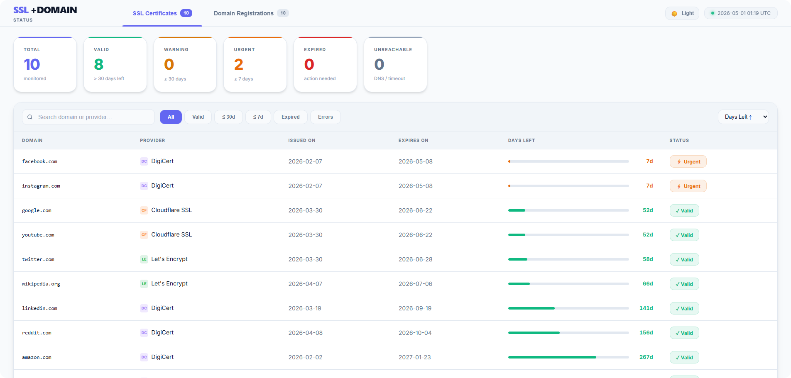
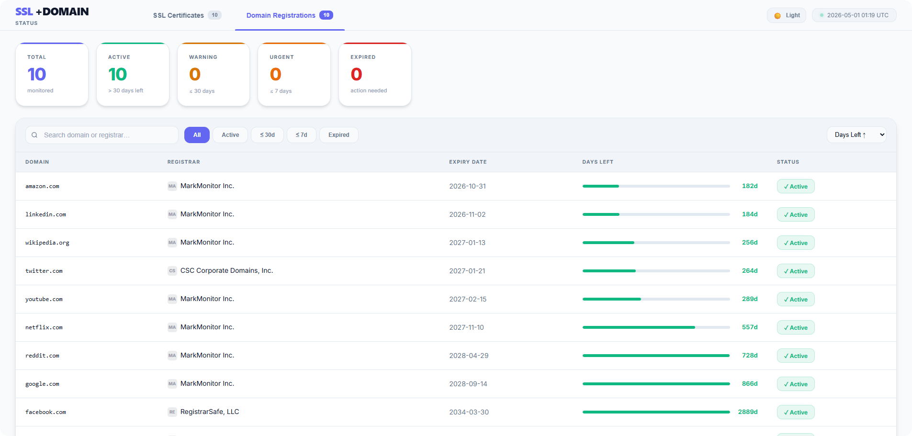
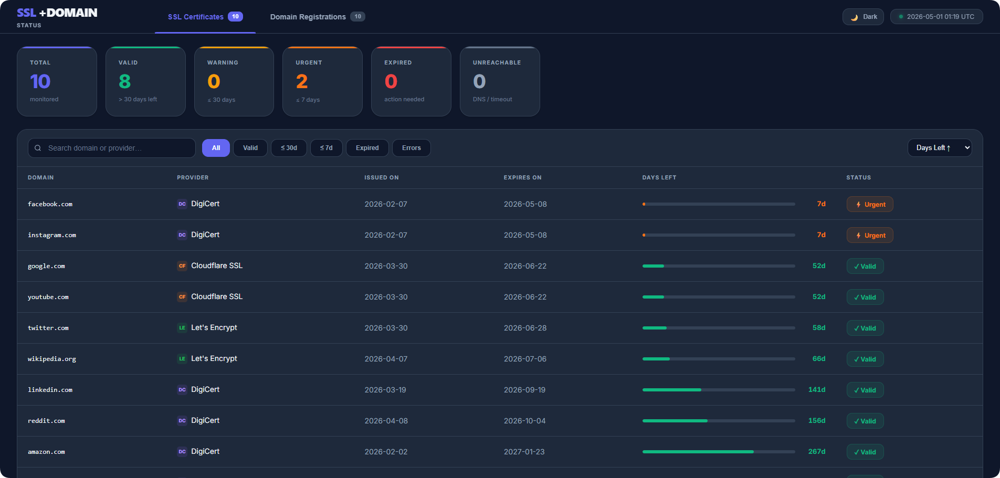

# certiwatch


### SSL Certificates


### Domain Registrations


### Dashboard — Dark Mode


---

certiwatch is a lightweight monitoring toolkit for:

- SSL/TLS certificate health checks
- Domain expiry tracking
- Config validation and auto-cleaning

It reads domain lists from plain text config files, runs checks in parallel, and writes JSON outputs that can be consumed by the dashboard or automation.

## Features

- SSL certificate inspection
- Detects provider/issuer (Let's Encrypt, Cloudflare, DigiCert, and more)
- Reports issue date, expiry date, remaining days, and status
- Handles common SSL failures (expired, hostname mismatch, self-signed, DNS/timeout/no HTTPS)
- Domain expiry checks
- Uses RDAP and WHOIS fallback for global domains
- Uses register.domains.lk API helper for .lk domains
- Normalizes registrar names (for cleaner reporting)
- Validates malformed entries
- Removes duplicates
- Normalizes values (lowercase, strips protocol and path)
- Optional DNS reachability checks

## Project Files

- `certiwatch.toml` - Unified target, threshold, history and alert configuration
- `schema/certiwatch.schema.json` - JSON Schema for `certiwatch.toml`
- `domains.conf` - Legacy input list for domain expiry checks (used only without TOML)
- `ssl.conf` - Legacy input list for SSL certificate checks (used only without TOML)
- `index.html` - Dashboard (fetches both result files and optional history on load)
- `pages/_headers` - Cloudflare Pages cache and MIME policy
- `scripts/build_dist.py` - Atomic, allowlisted Pages bundle builder
- `scripts/build_public_feeds.py` - Status, badge and ICS feed builder
- `scripts/alert_state_store.py` - Private alert-state pull/push for Cloudflare KV
- `scripts/test_build_dist.py` - Offline staging tests
- `tests/` - Offline pytest and `node --test` suites used by CI
- `requirements.txt` - Python runtime dependencies
- `src/config.py` - TOML loading and validation
- `src/monitor_state.py` - Public history and private alert state
- `src/validate_conf.py` - Config validator + legacy auto-fixer
- `src/domain/scripts/check_domains.py` - Domain expiry checker
- `src/domain/scripts/check_LK_domains.py` - .lk expiry helper
- `src/ssl/scripts/check_ssl.py` - SSL checker

Generated, not stored in Git:

- `ssl_results.json` - Output from the SSL checker
- `domain_results.json` - Output from the expiry checker
- `history.json` - Public daily snapshots, capped by the configured limit
- `.certiwatch/alert_state.json` - **Private** observations and pending events
- `dist/` - Publish directory produced by `scripts/build_dist.py`
- `feeds/` - Standalone feed output when the feed builder is run by hand

## Configuration Files

`certiwatch.toml` is the source of truth. The two legacy `.conf` files are read
only when the TOML file is absent; an existing but invalid TOML file is always
an error and never silently falls back. The production workflow requires
`certiwatch.toml` and does not need either `.conf` file.

### certiwatch.toml

```toml
version = 1

[defaults]
ssl_port = 443
thresholds = [30, 14, 7, 1]   # notice, warning, urgent, critical bands
history_limit = 365

[alerts]
discord = false               # delivery is also opt-in per workflow run

[[targets]]
domain = "example.com"        # host, host:port or URL
registration = true           # registration checks are opt-in
tags = ["public", "core"]     # public metadata
group = "corporate"           # public metadata
owner = "ops@example.com"     # not emitted, but this TOML is public in Git
notes = "Primary site."       # not emitted, but this TOML is public in Git
```

`src/config.py` rejects unknown keys, duplicate TLS endpoints or registration
domains, a port conflict, non-descending thresholds and targets with both
checks disabled. `owner` and `notes` are not copied into generated files, but
**the tracked TOML itself is public**: treat every value in it as public and
never put secrets there. See `docs/monitoring-lifecycle.md` for the full
contract.

### domains.conf (legacy)

Purpose:

- Used by the domain expiry checker only when `certiwatch.toml` is absent
- One domain per line
- Supports comments and blank lines

Accepted examples:

```text
example.com
www.example.org
https://sample.net/path
```

What the tool does automatically:

- Converts to lowercase
- Removes http:// and https://
- Removes paths and trailing dots/spaces
- Removes leading `www.` for registration checks. TLS checks preserve it and accept `host:port`.
- Deduplicates entries

### ssl.conf (legacy)

Purpose:

- Used by the SSL certificate checker only when `certiwatch.toml` is absent
- One domain per line
- Supports comments and blank lines

Accepted examples:

```text
example.com
api.example.com
https://portal.example.org/login
```

What the tool does automatically:

- Converts to lowercase
- Removes protocol, path, trailing dots/spaces
- Deduplicates entries
- Skips obviously invalid malformed entries

## Requirements

- Python 3.11+ (the workflow uses 3.13)
- `cryptography`, `jsonschema` and, on Python < 3.11, `tomli`
- Python package: cryptography

Python 3.13 or newer is recommended: the checker can then read the full
certificate chain the server presents (`chain_source: "verified"`), and CI uses
3.13. On older interpreters only the leaf certificate is reported.

Install dependency:

```bash
python3 -m pip install -r requirements.txt
```

## Usage

Run from repository root.

### 1. Validate the unified configuration (recommended first)

```bash
python3 src/validate_conf.py --no-dns
```

Validate a specific TOML file:

```bash
python3 src/validate_conf.py --config certiwatch.toml --no-dns
```

To also validate and auto-fix the legacy `.conf` files, add `--legacy`.

### 2. Run SSL checks

```bash
python3 src/ssl/scripts/check_ssl.py --config certiwatch.toml
```

Output is written to `ssl_results.json`.

### 3. Run domain expiry checks

```bash
python3 src/domain/scripts/check_domains.py --config certiwatch.toml
```

Output is written to `domain_results.json`.

### 4. Build public history and private alert state

```bash
python3 src/monitor_state.py \
  --config certiwatch.toml \
  --ssl-results ssl_results.json \
  --domain-results domain_results.json \
  --history history.json \
  --alert-state .certiwatch/alert_state.json \
  --transport none
```

`--transport none` is the default and makes no network request. It writes the
public `history.json` and the **private** `.certiwatch/alert_state.json`; the
latter must never be published, cached in Actions or committed.

### 5. Preview the published bundle locally

```bash
python3 scripts/build_dist.py --out dist
python3 -m http.server --directory dist 8000
```

`dist/` is exactly what Cloudflare Pages receives. It contains the dashboard,
both result files, optional history, `status.json`, `expiries.ics` and the
per-domain badges. The build fails if a required input is missing, empty or not
valid result JSON or history; it also refuses symlinked inputs, an unsafe
destination, a malformed history file, and a TLS run in which no certificate
could be read. See [Publish safety rules](#publish-safety-rules).

## Generated data and Git

`ssl_results.json` and `domain_results.json` are build artifacts, not source:

- They are git-ignored and no longer committed. A fresh clone has neither file
  until you run the checkers.
- Every publishing run regenerates them on the runner and publishes only those
  generated copies. The live result JSON is replaced each deployment; the
  separate public `history.json` is the only retained history, and it is kept in
  the Actions cache rather than Git.
- The workflow has `permissions: contents: read` and no commit step; it cannot
  write results back to `main`. What is in the repository and what the site
  serves therefore differ by design.
- Missing, empty, unparseable or zero-row result files fail the build before
  anything is deployed, rather than publishing an empty or broken dashboard.
- A TLS run in which every row is a DNS, connection, handshake or input failure
  also fails the build: no certificate was read, so the published results stay
  as they were. Runs that contain real certificate verdicts publish normally,
  including `expired` and `invalid` rows.

`history.json` is public and regenerated from the two result files:

- At most one snapshot per UTC date; a second run that day replaces it.
- The newest `history_limit` snapshots are kept (365 by default). Rows are
  sorted by domain so diffs stay stable.
- It never contains `owner`, `notes`, tags, group or alert data.
- In CI it is restored from and saved to the Actions cache on `main` only.
  Caches that go unused for 7 days are evicted and the repository cache is
  capped at 10 GB, so a missing cache starts a new history file rather than
  blocking a publish. See [Public history retention](#public-history-retention).

`.certiwatch/alert_state.json` is **private**:

- It holds last-seen status, alert band, certificate fingerprint and pending
  delivery events.
- It is git-ignored and is never part of `dist/`, an Actions cache or an
  uploaded artifact.
- The optional CI path uses a dedicated Cloudflare KV namespace; without one,
  Discord delivery is disabled (see [Alert delivery](#alert-delivery)).

## Environment Variables

- `DOMAIN_CHECK_DELAY_SEC` - Delay between outbound domain lookup requests (default: 0.35)
- `LK_CHECK_DELAY_SEC` - Delay for .lk API requests (default: 0.8)
- `LK_CHECK_MAX_RETRIES` - Retry count for .lk API failures (default: 3)
- `CERTIWATCH_DISCORD_WEBHOOK` - Discord webhook secret; required only for opt-in delivery
- `CERTIWATCH_STATE_KV_TOKEN` - API token scoped to the private KV namespace; never commit it
- `CERTIWATCH_STATE_KV_NAMESPACE` - KV namespace id for private alert state
- `CLOUDFLARE_ACCOUNT_ID` - Cloudflare account id for the KV state adapter

Example:

```bash
DOMAIN_CHECK_DELAY_SEC=0.5 LK_CHECK_MAX_RETRIES=5 python3 src/domain/scripts/check_domains.py
```

## Result Status Meanings

SSL status values commonly include:

- `valid`
- `expired`
- `invalid`
- `dns_error`
- `timeout`
- `ssl_error`
- `no_https`
- `error`

Domain expiry status values commonly include:

- `active`
- `warning`
- `urgent`
- `expired`
- `unknown`

## Trust and interpretation limits

The SSL checker reports what the machine that ran it could verify. Read these
fields with that in mind:

- `trusted_chain` uses the trust store of the runner: the OpenSSL defaults of
  the Python installation, or the bundle named in `SSL_CA_FILE`. A certificate
  that works in a browser can be reported `invalid` here when the runner lacks a
  recently added root; a private CA is trusted only after it is added to that
  store. `chain_error` keeps the raw verification message.
- A server that does not send its intermediate certificates produces a chain
  error even though browsers can often fill the gap themselves. That is a real
  server configuration problem, not a checker failure, and it is reported as
  `invalid` with the verification text.
- Chain trust and hostname coverage are judged separately. `trusted_chain: true`
  with `hostname_matches: false` means the certificate is genuine but issued for
  another name; `trusted_chain: false` with `hostname_matches: true` means the
  chain itself did not validate.
- Hostname matching uses the SAN entries only, per RFC 6125 and the CA/Browser
  Forum baseline requirements; a subject CN is never accepted as a substitute.
- The presented chain is read through `get_verified_chain` /
  `get_unverified_chain`, available on Python 3.13+. Older interpreters report
  the leaf only and set `chain_source` to `"leaf"`.
- Revocation (OCSP/CRL) is **not** checked: `revocation_checked` is always
  `false` and `revocation_status` is `not_checked`.
- Expiry is decided by the exact `not_after` timestamp (`is_expired`).
  `days_left` is floored for display, so a certificate with hours left can show
  `0` days and still be `valid`.
- Domain expiry uses RDAP with a WHOIS fallback, and the register.domains.lk
  helper for `.lk`. An `unknown` status means neither source answered - not that
  the domain is unregistered.
- A jump in `www.` availability is reported, not hidden: when the configured
  host cannot be reached on port 443, the row keeps its own failure status and a
  separate `fallback` object may carry the `www.<host>` result.

## Suggested Workflow

1. Update `certiwatch.toml` (legacy installations: `domains.conf` and `ssl.conf`).
2. Run `python3 src/validate_conf.py --no-dns`.
3. Run SSL and domain checks.
4. Run `src/monitor_state.py --transport none` to update public history and private state.
5. Build `dist/` to preview exactly what will be published.

The full lifecycle contract — history schema, alert key stability, KV state,
at-least-once delivery and CI inputs — is in
[`docs/monitoring-lifecycle.md`](docs/monitoring-lifecycle.md).

## GitHub Actions Automation

`.github/workflows/ssl-check.yml` runs the checks and publishes the dashboard to
Cloudflare Pages. It is the only deployment path; nothing is deployed by hand.

### Triggers

| Trigger | What runs |
|---|---|
| `pull_request` | `pr-verify.yml` calls the reusable offline checks. A pull request never publishes, needs no secrets, and makes no external probes. |
| `push` to `main` | `ssl-check.yml` runs the same offline checks, then the certificate checks and a publish. Only for files that affect the checks, the dashboard or the published bundle. |
| `schedule` | Every day at **06:00 Asia/Colombo (UTC+5:30)**, i.e. **00:30 UTC**. |
| `workflow_dispatch` | Manual run from the GitHub Actions tab. Publishes only from `main`. |

Superseded pull-request runs are cancelled. A run on `main` is never cancelled
mid-publish: a second one waits behind it (`concurrency: certiwatch-${{ github.ref }}`).

### Automated checks

The `verify` job runs offline on every trigger and must pass before anything can
be published:

| Check | Command |
|---|---|
| Unified config contract (offline) | `python3 src/validate_conf.py --config certiwatch.toml --no-dns` |
| Python unit tests (in-memory certificates, local TLS servers/fakes only) | `python -m pytest -q -p no:cacheprovider` |
| Dashboard tests | `node --test tests/dashboard.test.mjs` |
| Publish-bundle and feed tests | `python3 scripts/test_build_dist.py` |

Run the same four commands before opening a pull request. None needs network
access, credentials, previous history or private state, so a pull request can be
verified on a fork. Pull requests do not run either checker, do not restore the
history cache, do not touch the KV namespace and cannot deploy.

The checks live in the reusable, no-secret `verify.yml`. A dedicated
`pr-verify.yml` calls it on every pull request, and the production workflow
calls the same reusable job as its `publish` dependency. The split means PR
verification can run even when the production workflow has been disabled for
repository inactivity; the PR workflow has no secrets and no publish path.

The publish job declares `needs: verify` and runs only for
`github.ref == 'refs/heads/main'`, so a `main` run - push, schedule or manual -
cannot deploy unless every check passes first. A feature-branch dispatch is
skipped rather than writing state or publishing.

### What a publishing run does

1. Fails when a required input is missing, empty or a symlink (`certiwatch.toml`,
   `schema/certiwatch.schema.json`, `index.html`, `pages/_headers`,
   `scripts/build_dist.py`, `scripts/build_public_feeds.py`,
   `scripts/alert_state_store.py`, `src/config.py`, `src/monitor_state.py`).
2. Validates `certiwatch.toml` against the schema (the legacy `.conf` files are
   not consulted while TOML exists).
3. Restores public `history.json` from the Actions cache on `main` only.
4. Runs the SSL and domain checkers with `--config certiwatch.toml`.
5. Optionally pulls the private alert state from the dedicated KV namespace.
6. Runs `src/monitor_state.py`: writes the public history snapshot, writes the
   pending batch to the remote KV checkpoint, and only then delivers opt-in
   events. A checkpoint failure means zero sends.
7. Saves public history back to the Actions cache even after a delivery
   warning. `monitor_state.py` owns all private checkpoint writes; there is no
   redundant post-run KV put.
8. Stages the atomic publish directory with `scripts/build_dist.py`, including
   the feeds and history.
9. Deploys `dist/` to Cloudflare Pages, from `main` only.

It does **not** commit the results back to `main`; see
[Generated data and Git](#generated-data-and-git).

### Publish safety rules

`scripts/build_dist.py` refuses to build rather than publish something wrong:

- **Missing, empty or malformed input**, including a result file with no rows.
- **Unreadable TLS run**: when *every* SSL row ended in DNS, connection,
  handshake or input failure (`dns_error`, `timeout`, `no_https`, `ssl_error`,
  `error`), no certificate was read. That is a runner without egress or a
  network outage, so production is left untouched. Any run containing at least
  one real verdict (`valid`, `expired`, `invalid`) publishes normally, so
  expiring and invalid certificates are still reported.
- **Symlinked inputs**: a symlinked file, or a symlinked parent directory such as
  `pages`, is refused, so nothing outside the checkout can enter the bundle.
- **Malformed public history**: a present `history.json` must be an object with
  a non-empty `snapshots` list, valid unique `YYYY-MM-DD` dates and both row
  lists. Invalid history fails the build instead of publishing a corrupt chart.
- **Unsafe destinations**: output outside the checkout is allowed; inside it only
  `dist` is. A non-empty destination is replaced only if every entry is a file
  this builder produces and `_headers` is present; otherwise it is refused and
  left intact.
- **Strict generated allowlist**: feed output is limited to `status.json`,
  `expiries.ics`, `badges/manifest.json` and badge names matching
  `<slug>-<sha256:32>.svg`. A foreign nested file or directory under `badges/`
  refuses the rebuild. A repeat build accepts the previous bundle, including a
  stale badge it will replace.

The build assembles a hidden sibling directory, generates the feeds into it,
and swaps it into place at the end. A failed feed, history or copy step never
leaves a half-filled `dist/` behind for a deploy step to publish.

### Published bundle

Only the files below are uploaded:

| Path in `dist/` | Source | Required |
|---|---|---|
| `index.html` | `index.html` | yes |
| `ssl_results.json` | generated by `check_ssl.py` | yes |
| `domain_results.json` | generated by `check_domains.py` | yes |
| `_headers` | `pages/_headers` | yes |
| `status.json` | generated by `build_public_feeds.py` | yes |
| `expiries.ics` | generated by `build_public_feeds.py` | yes |
| `badges/manifest.json` | generated by `build_public_feeds.py` | yes |
| `badges/<slug>-<sha256>.svg` | generated by `build_public_feeds.py` | yes, one per domain |
| `history.json` | generated by `monitor_state.py` | no, copied when present |
| `app.js` | `app.js` | no, copied when present |
| `style.css` | `style.css` | no, copied when present |

`scripts/build_dist.py` owns this list. Sources, images, workflows, private
state and configuration never reach the public site. Badge names are dynamic,
so the builder accepts only the manifest plus the exact hash-suffixed SVG
pattern; adding any other runtime file means an explicit reviewed change.

`pages/_headers` sets `no-cache, must-revalidate` on the four JSON endpoints so
a new deployment is visible immediately. The calendar and badges may be reused
for five minutes (`max-age=300`) and then revalidate. It also sets
`application/json`, `text/calendar` and `image/svg+xml` content types. Confirm
the served headers once after the first deploy; Pages controls some MIME types
itself.

### Public endpoints

After a publish, the feeds are available at:

| URL | Content |
|---|---|
| `/status.json` | machine-readable summary and per-domain status |
| `/expiries.ics` | RFC 5545 calendar of certificate and registration expiries |
| `/badges/manifest.json` | domain → badge path/status/colour/sha256 |
| `/badges/<slug>-<sha256>.svg` | one deterministic badge per domain |
| `/history.json` | public daily snapshots for the dashboard sparkline |

### Public history retention

The publish job restores `history.json` from `actions/cache` using a
`certiwatch-history-` key prefix and saves a new `certiwatch-history-<run>-<attempt>`
entry. The cache is public data and is used on `main` only; pull requests never
restore or write it.

GitHub evicts cache entries that have not been used for 7 days and caps a
repository's cache at 10 GB, removing the least-recently-used entries first.
History files are small, but a trivially long pause or cache purge can cause the
next run to start with a single snapshot. The dashboard treats history as
optional; losing it never blocks a publish. Keep history out of the private
alert-state namespace and out of any artifact upload.

### Alert delivery

Alerting is opt-in twice:

1. `[alerts] discord = true` in `certiwatch.toml`.
2. `CERTIWATCH_ALERTS_ENABLED` repository variable set to `true` (and the
   webhook secret configured).

`src/monitor_state.py` writes the public history and private pending state
locally, then writes the pending batch to the remote checkpoint **before** it
calls Discord. Only a 2xx acknowledgement clears the local batch and then the
remote checkpoint. If the checkpoint write fails, the run aborts with **zero
sends**. If delivery fails, the batch remains pending in both places. This is
at-least-once: a crash after the send but before the clear, or a failed
checkpoint-clear write, can duplicate an alert; a lost runner cannot lose the
batch. A delivery failure is reported as a workflow warning and does not prevent
the dashboard publish.

`--transport discord` requires `--checkpoint local` (genuinely persistent host)
or `--checkpoint kv` (CI). The workflow chooses `kv` only when
`CERTIWATCH_STATE_KV_NAMESPACE` is configured and refuses to enable alerts
otherwise. With delivery disabled, pending events are preserved rather than
discarded; the backlog can grow while alerts are off and is bounded by the 2 MB
KV state limit. A PUT failure, including a 404, is a checkpoint failure and
sends nothing; a missing GET key is a first run.

Messages are split into bounded batches. Every event is sent exactly once per
attempt, and after each acknowledged batch only the unacknowledged events remain
in the local and remote state. An oversized single event fails the run rather
than being truncated. The private state is never written to the repository, a
Pages bundle, an Actions cache or an uploaded artifact.

### Required GitHub configuration

Add these under **Settings → Secrets and variables → Actions**:

| Name | Kind | Description |
|---|---|---|
| `CLOUDFLARE_API_TOKEN` | secret | Cloudflare API token with Pages edit permission |
| `CLOUDFLARE_ACCOUNT_ID` | secret | Cloudflare account ID |
| `CLOUDFLARE_PAGES_PROJECT` | variable, optional | Pages project name; defaults to `certiwatch` |
| `CERTIWATCH_STATE_KV_TOKEN` | secret, optional | Separate KV-edit token used only for this namespace; do not reuse the Pages token |
| `CERTIWATCH_STATE_KV_NAMESPACE` | variable, optional | Dedicated KV namespace id for private alert state |
| `CERTIWATCH_ALERTS_ENABLED` | variable, optional | Set to `true` to allow Discord delivery; default off |
| `CERTIWATCH_DISCORD_WEBHOOK` | secret, optional | Discord webhook URL, read by `monitor_state.py` only |

Create the KV namespace and its token manually in Cloudflare; this repository
never creates or rotates credentials. A separate token limited to **Workers KV
Storage:Edit** for the account is enough, and the adapter is used only with this
namespace. The workflow writes the key `certiwatch-alert-state`; it does not
list or read any other key. If the KV variables are absent, the workflow skips
both KV steps and runs with `--transport none`.

The deploy step is pinned to the verified `cloudflare/wrangler-action` release
`v3.15.0` commit (`9acf94a…`) instead of a moving major tag, so a retagged or
compromised tag cannot change what runs with the API token. `checkout` runs with
`persist-credentials: false`; no step pushes to Git.

### Live Dashboard

The dashboard is deployed to Cloudflare Pages and updates after each workflow run:

**https://certiwatch.pages.dev**

A Pages hostname is `<project-name>.pages.dev`, so the workflow deploys to the
project `certiwatch`. **The production Cloudflare account mapping is unverified**:
the previous workflow targeted a project named `ssl-domain-monitor`, and
confirming the real one needs Cloudflare dashboard access or a deploy, neither
of which happens from this repository. Before the first run, check
**Workers & Pages** in Cloudflare:

- if the project is already `certiwatch`, no change is needed;
- if it is still `ssl-domain-monitor` (which serves `ssl-domain-monitor.pages.dev`),
  either rename the project to `certiwatch`, or set the
  `CLOUDFLARE_PAGES_PROJECT` repository variable to the real project name and
  update this URL.

If neither exists, the first deploy creates the project.

### 60-day inactivity caveat

GitHub disables scheduled workflows in a repository after 60 days without
activity. If the project is untouched that long, the daily run stops and the
site keeps showing the last published data. The workflow can then be reported
as `disabled_inactivity`; a push does not necessarily re-enable it. Open
**Actions → CertiWatch checks** and choose **Enable workflow**, then run it once
manually and check the result files' `generated_at` values.

At the time of this change, the repository's production workflow is in exactly
that state: the last run was **2026-08-31** and the workflow API reports
`state: disabled_inactivity`. This is a repository setting, not a YAML or
path-filter failure; enabling it requires repository admin access and was not
done here. The separate `pr-verify.yml` workflow is not the disabled workflow,
so PR checks can still run without enabling production or supplying secrets.

### Rollback

Cloudflare Pages keeps every deployment. To revert a bad publish, open
**Workers & Pages → certiwatch → Deployments**, pick the last known-good
deployment and choose **Rollback**. The site then serves that deployment's
bundle, including its result files, until the next successful run. No Git revert
is needed for a rollback; revert the offending commit separately if it also
changed the dashboard, configuration or checks.

The build step prints a manifest of every published file with its size and
SHA-256 prefix, so the log of a run identifies exactly what was deployed.
