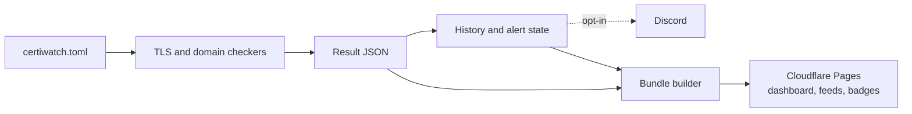

<!-- prettier-ignore -->
<div align="center">

# CertiWatch

**Catch expiring TLS certificates and domain registrations before your users do.**

[](https://github.com/nooblk-98/certiwatch/actions/workflows/ssl-check.yml)
[](https://www.python.org)
[](.github/workflows/ssl-check.yml)
[](https://pages.cloudflare.com)

[Live demo](https://ssl-domain-monitor.pages.dev) • [Features](#features) • [Quickstart](#quickstart) • [Configuration](#configuration) • [Deployment](#deploy-with-github-actions) • [Public feeds](#public-feeds) • [Lifecycle docs](docs/monitoring-lifecycle.md)


</div>

CertiWatch is a self-hosted certificate and domain expiry monitor that needs no server or database. List your domains in one TOML file, and a daily GitHub Actions run checks them, then publishes a static dashboard, a status API, a calendar feed, and badges to Cloudflare Pages.

## Features

- **TLS certificate checks**: issuer, validity dates, chain trust, SAN hostname match, and fingerprint changes, on any port.
- **STARTTLS support**: monitor SMTP, IMAP, and POP3 endpoints alongside HTTPS.
- **Domain expiry tracking**: RDAP with a WHOIS fallback, plus a dedicated lookup for `.lk` domains.
- **DNS and security diagnostics**: NS, CAA, DNSSEC, and HSTS checks, with optional legacy TLS 1.0/1.1 probing.
- **Interactive dashboard**: search, filter, sort, expiry timelines, history, light and dark themes, and CSV or JSON export.
- **Public feeds**: `status.json`, an iCalendar expiry feed, and an SVG badge for each domain.
- **Discord alerts**: opt-in notifications for status, threshold, and certificate changes, with at-least-once delivery.
- **Safe publishing**: a run that could not read any certificate fails the build and leaves the live site untouched.

## How it works



Results are build artifacts and are never committed back to the repository. Public history is kept in the GitHub Actions cache, and private alert state is kept in an optional Cloudflare KV namespace.

## Quickstart

You need [Python 3.11+](https://www.python.org/downloads/). Python 3.13+ is recommended because older versions can only report the leaf certificate instead of the full chain.

```bash
git clone https://github.com/nooblk-98/certiwatch.git
cd certiwatch
python3 -m venv .venv
source .venv/bin/activate  # Windows: .venv\Scripts\activate
python -m pip install -r requirements.txt
```

Edit the targets in `certiwatch.toml`, then run the checks and build the site:

```bash
python src/validate_conf.py --no-dns
python src/ssl/scripts/check_ssl.py --config certiwatch.toml
python src/domain/scripts/check_domains.py --config certiwatch.toml
python src/monitor_state.py --config certiwatch.toml --transport none
python scripts/build_dist.py --out dist
python -m http.server --directory dist 8000
```

Open <http://localhost:8000> to see your dashboard.

> [!TIP]
> `--transport none` is the default and sends no alerts, so it is safe for local runs.

## Configuration

All monitoring is configured in [`certiwatch.toml`](certiwatch.toml) and validated against [a JSON Schema](schema/certiwatch.schema.json). Unknown keys are rejected, so a typo cannot silently disable a check.

```toml
version = 1

[defaults]
ssl_port = 443
thresholds = [30, 14, 7, 1]  # notice, warning, urgent, critical (days)
history_limit = 365
check_dns = true
check_hsts = true
check_legacy_tls = false

[alerts]
discord = false

# HTTPS certificate and domain registration
[[targets]]
domain = "example.com"
registration = true
tags = ["public", "core"]
group = "corporate"

# Mail server over STARTTLS
[[targets]]
domain = "mail.example.com"
ssl_port = 587
tls_mode = "starttls"
starttls_protocol = "smtp"
```

> [!WARNING]
> `owner` and `notes` are left out of generated files, but `certiwatch.toml` is tracked in Git. In a public repository every value is public, so never put secrets in it.

### Target options

| Option | Default | Description |
| --- | --- | --- |
| `domain` | required | Host, `host:port`, or URL |
| `ssl` | `true` | Check the TLS certificate |
| `registration` | `false` | Check domain registration expiry |
| `ssl_port` | `443` | TLS port for this target |
| `tls_mode` | `direct` | `direct` or `starttls` |
| `starttls_protocol` | `smtp` | `smtp`, `imap`, or `pop3` |
| `https` | auto | Whether the endpoint serves HTTPS. HSTS is only checked when true |
| `dns_name` | registration domain | Name used for NS, CAA, and DNSSEC checks |
| `check_dns`, `check_hsts`, `check_legacy_tls` | from `[defaults]` | Per-target diagnostic overrides |
| `tags`, `group` | none | Public metadata included in results |
| `owner`, `notes` | none | Reference fields that are not emitted |

### Environment variables

| Variable | Default | Description |
| --- | --- | --- |
| `SSL_CHECK_TIMEOUT` | `15` | TLS connection timeout in seconds |
| `SSL_CHECK_WORKERS` | `20` | Parallel TLS checks |
| `SSL_CA_FILE` | system store | Custom CA bundle, for example for a private CA |
| `DOMAIN_CHECK_DELAY_SEC` | `0.35` | Delay between domain lookups |
| `LK_CHECK_DELAY_SEC` | `0.8` | Delay between `.lk` lookups |
| `LK_CHECK_MAX_DELAY_SEC` | `5.0` | Maximum `.lk` retry delay |
| `LK_CHECK_MAX_RETRIES` | `3` | Retries for failed `.lk` lookups |

## Deploy with GitHub Actions

The [`CertiWatch checks`](.github/workflows/ssl-check.yml) workflow runs daily at 00:30 UTC, on relevant pushes to `main`, and on demand. Offline tests must pass before anything is published. Pull requests run the same tests without secrets and never deploy.

1. Fork this repository and edit `certiwatch.toml`.
2. Add the settings below under **Settings > Secrets and variables > Actions**.
3. Open the **Actions** tab, select **CertiWatch checks**, and choose **Run workflow**.

| Name | Type | Required | Description |
| --- | --- | --- | --- |
| `CLOUDFLARE_API_TOKEN` | Secret | Yes | Token with Cloudflare Pages edit permission |
| `CLOUDFLARE_ACCOUNT_ID` | Secret | Yes | Cloudflare account ID |
| `CLOUDFLARE_PAGES_PROJECT` | Variable | No | Pages project name, defaults to `certiwatch` |
| `CERTIWATCH_ALERTS_ENABLED` | Variable | For alerts | Set to `true` to allow Discord delivery |
| `CERTIWATCH_DISCORD_WEBHOOK` | Secret | For alerts | Discord webhook URL |
| `CERTIWATCH_STATE_KV_NAMESPACE` | Variable | For alerts | Dedicated KV namespace for private alert state |
| `CERTIWATCH_STATE_KV_TOKEN` | Secret | For alerts | Separate token limited to Workers KV Storage edit |

> [!IMPORTANT]
> GitHub disables scheduled workflows after 60 days of repository inactivity, and the dashboard then keeps showing its last published data. To resume monitoring, re-enable **CertiWatch checks** in the **Actions** tab and run it once.

### Enable Discord alerts

Alerts must be enabled in two places: set `discord = true` under `[alerts]` in `certiwatch.toml`, and set `CERTIWATCH_ALERTS_ENABLED` to `true`. CI also requires the KV namespace, because alert state must survive between runs.

The first run records a baseline and sends nothing. After that, CertiWatch alerts on status changes, threshold crossings, and certificate fingerprint changes. Failed deliveries are retried on the next run, so a duplicate alert is possible but a lost one is not.

## Public feeds

Every deployment publishes these endpoints alongside the dashboard:

| Path | Content |
| --- | --- |
| `/status.json` | Overall status, summary counts, and per-domain results |
| `/expiries.ics` | Calendar of certificate and registration expiries |
| `/history.json` | Daily snapshots, up to `history_limit` |
| `/badges/manifest.json` | Map of each domain to its badge, status, and color |
| `/badges/<slug>-<sha256>.svg` | Status badge for one domain |

Subscribe to `/expiries.ics` from your calendar app to see renewals next to the rest of your schedule.

## Reading the results

| Certificate status | Meaning |
| --- | --- |
| `valid` | The certificate is trusted, matches the host, and has not expired |
| `expired` | The certificate is past its expiry date |
| `invalid` | Chain or hostname verification failed |
| `dns_error`, `timeout`, `no_https`, `ssl_error`, `error` | The check could not read a certificate |

Domain registrations report `active`, `warning`, `urgent`, `expired`, or `unknown`. `unknown` means no lookup source answered, not that the domain is unregistered.

> [!NOTE]
> CertiWatch does not check certificate revocation (OCSP or CRL). Trust is evaluated against the CA store of the machine running the check, so a certificate that works in a browser can be `invalid` if the server omits an intermediate or the runner lacks a recent root.

## Development

Run the same offline checks as CI before opening a pull request. Node.js 22+ is needed for the dashboard tests.

```bash
python -m pip install -r requirements.txt pytest
python src/validate_conf.py --config certiwatch.toml --no-dns
python -m pytest -q -p no:cacheprovider
node --test tests/dashboard.test.mjs
python scripts/test_build_dist.py
```

> [!NOTE]
> Some tests create symlinks. On Windows, enable Developer Mode or run them from an elevated shell.

```text
├── certiwatch.toml    # Monitoring configuration
├── index.html         # Dashboard (with app.js and style.css)
├── schema/            # Configuration JSON Schema
├── src/               # Checkers, config loader, history, and alerts
├── scripts/           # Bundle, feed, and alert-state tooling
├── pages/_headers     # Cloudflare Pages cache and MIME rules
├── tests/             # Offline Python and dashboard tests
└── docs/              # Monitoring lifecycle reference
```

For the history schema, alert state model, failure handling, and CI contract, see the [monitoring lifecycle documentation](docs/monitoring-lifecycle.md).
